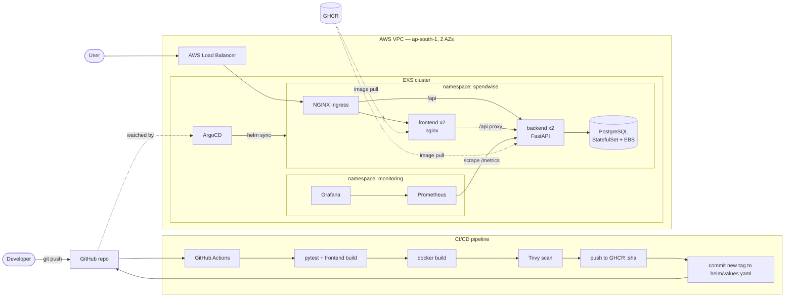

# SpendWise: DevSecOps Expense Tracker

SpendWise is a personal expense tracker. You log what you spend, sort it into categories and see where the money goes. The app itself is deliberately small. The point of the project is everything around it: a full DevSecOps delivery pipeline from `git push` to a monitored Kubernetes deployment on AWS.

| Layer | What it does |
|---|---|
| **App** | React UI, FastAPI REST API, PostgreSQL (Alembic migrations) |
| **Quality** | 10 pytest cases against an isolated SQLite test DB |
| **Containers** | Non-root images; multi-stage frontend build; one-command `docker compose` stack |
| **CI/CD** | GitHub Actions: test, build, Trivy scan, push to GHCR (SHA tags), GitOps bump |
| **Security** | Trivy fails the pipeline on fixable HIGH/CRITICAL CVEs |
| **Infra** | Terraform: VPC (2 public + 2 private subnets), EKS with a managed node group |
| **Deploy** | Helm chart synced by ArgoCD; NGINX Ingress routes `/` to the frontend and `/api` to the backend |
| **Observability** | `/metrics`, Prometheus ServiceMonitor, Grafana dashboard provisioned as code |

---

## Architecture



**Request flow:** browser → AWS ELB → NGINX Ingress → `/` goes to the frontend pods (static React bundle), `/api/*` goes to the backend pods → PostgreSQL.

### Repository layout

```
.
├── backend/                 FastAPI app
│   ├── app/                 main.py (routes), models.py, schemas.py, db.py, config.py
│   ├── alembic/versions/    DB migrations (0001_create_expenses)
│   ├── tests/               pytest suite + conftest (SQLite test DB)
│   └── Dockerfile           python:3.12-slim, runs as UID 10001
├── frontend/                React + Vite SPA
│   ├── src/                 main.jsx, api.js, styles.css
│   ├── nginx.conf.template  serves SPA, proxies /api to backend
│   └── Dockerfile           multi-stage: node build → nginx-unprivileged
├── docker-compose.yml       frontend + backend + postgres
├── .github/workflows/       ci-cd.yml
├── terraform/               VPC + EKS (+ EBS CSI driver)
├── k8s/namespace.yaml       namespace bootstrap
├── helm/spendwise/          Helm chart (deployments, services, ingress, HPA, postgres, ServiceMonitor, dashboard)
├── argocd/application.yaml  GitOps Application
├── monitoring/              kube-prometheus-stack values
├── scripts/load-test.sh     traffic generator for Grafana
└── demo/                    presentation video + slides
```

---

## Tech stack

| Category | Tools |
|---|---|
| Languages | Python 3.12, JavaScript (React 18), HCL, YAML |
| Backend | FastAPI, SQLAlchemy 2, Alembic, Pydantic v2, prometheus-fastapi-instrumentator |
| Frontend | React 18, Vite 6, NGINX (unprivileged) |
| Database | PostgreSQL 16 |
| Testing | pytest, FastAPI TestClient, SQLite (in-memory) |
| Containers | Docker, Docker Compose |
| CI/CD | GitHub Actions, GitHub Container Registry (GHCR) |
| Security | Trivy |
| IaC | Terraform, terraform-aws-modules (vpc, eks, iam) |
| Cloud | AWS: VPC, EKS, EC2, EBS, ELB, IAM |
| Orchestration | Kubernetes, Helm, ArgoCD, NGINX Ingress Controller |
| Observability | Prometheus, Grafana (kube-prometheus-stack) |

---

## API

| Method | Path | Description |
|---|---|---|
| GET | `/health` | Liveness and readiness (also checks the DB connection) |
| GET | `/api/expenses?category=food` | List expenses, newest first, with an optional category filter |
| GET | `/api/expenses/{id}` | Get one expense |
| POST | `/api/expenses` | Create an expense |
| PUT | `/api/expenses/{id}` | Update an expense (partial: send only the fields you change) |
| DELETE | `/api/expenses/{id}` | Delete an expense |
| GET | `/api/summary` | Total spend and per-category breakdown |
| GET | `/metrics` | Prometheus metrics |
| GET | `/docs` | Swagger UI |

Example body: `{"title": "Groceries", "amount": "42.50", "category": "food", "spent_on": "2026-10-01", "note": "Weekly shop"}`.
Valid categories: `food, transport, housing, utilities, health, entertainment, shopping, other`.

---

## Local setup

### Option A: Docker Compose (recommended)

```bash
docker compose up --build
```

| URL | What |
|---|---|
| http://localhost:3000 | SpendWise UI |
| http://localhost:8000/docs | API docs (Swagger) |
| http://localhost:8000/metrics | Prometheus metrics |

The backend runs `alembic upgrade head` on startup, so the schema is created automatically. To reset the data, run `docker compose down -v`.

### Option B: run the services directly

```bash
# Postgres
docker run -d --name sw-pg -p 5432:5432 -e POSTGRES_DB=spendwise -e POSTGRES_USER=spendwise -e POSTGRES_PASSWORD=spendwise postgres:16-alpine

# Backend
cd backend
python -m venv .venv && source .venv/bin/activate
pip install -r requirements-dev.txt     # runtime deps + pytest/httpx
cp .env.example .env
alembic upgrade head
uvicorn app.main:app --reload            # http://localhost:8000

# Frontend (new terminal)
cd frontend
npm install
npm run dev                               # http://localhost:5173 (proxies /api to :8000)
```

### Tests

```bash
cd backend && pytest -v
```

The tests override the `get_db` dependency with an in-memory SQLite database (`tests/conftest.py`), so they never touch PostgreSQL. They cover health, create, validation (negative amount, unknown category), list and filter, get and 404, update, delete, summary and `/metrics`.

---

## CI/CD pipeline

The pipeline is defined in `.github/workflows/ci-cd.yml`. It runs on every push to `main`, on pull requests to `main` and on manual dispatch.

```
test ──► image (matrix: backend, frontend) ──► deploy (GitOps)
         build → Trivy scan → push :<sha>       bump tag in helm/spendwise/values.yaml
```

1. **test**: installs the backend dependencies and runs `pytest -v`. Any failure stops the pipeline, so no image gets built. It then runs `npm ci && npm run build` for the frontend.
2. **image**: runs once for the backend image and once for the frontend image, in parallel. Each run:
   - builds the image as `ghcr.io/<owner>/spendwise-<service>:<git-sha>`
   - scans it with **Trivy** (`--severity HIGH,CRITICAL --ignore-unfixed --exit-code 1`), so any fixable HIGH or CRITICAL CVE fails the build
   - logs in to GHCR with the built-in `GITHUB_TOKEN` and pushes. Only images that passed the scan are pushed. Pull requests build and scan but never push.
3. **deploy** (pushes to `main` only): rewrites the image `tag:` in `helm/spendwise/values.yaml` to the commit SHA and commits it back with `[skip ci]`. ArgoCD detects the change and rolls out the new version.

Images are tagged only with the immutable commit SHA, never `latest`. Every running pod can be traced back to the commit that built it.

**One-time GitHub setup:**
- Settings → Actions → General → Workflow permissions → **Read and write permissions** (lets the deploy job push the tag bump).
- After the first push, open each package (`spendwise-backend`, `spendwise-frontend`) under your GitHub profile → Packages → Package settings → **Change visibility → Public**. The alternative is to create a pull secret and set `imagePullSecrets` in `values.yaml`.

### DevSecOps: Trivy

Trivy scans each finished image. It checks the OS packages of the base image (Debian for the backend, Alpine for the frontend) and the application dependencies (Python wheels and the npm bundle) against vulnerability databases. `--ignore-unfixed` limits the gate to CVEs that have a fix available, so the build fails only on problems you can actually fix. The Dockerfiles run `apt-get upgrade` and `apk upgrade` to pull in patched OS packages, and both images use slim or Alpine bases to keep the attack surface small.

**Scan result: the gate caught real vulnerabilities.**
- **Frontend:** the first pipeline run passed with 0 findings.
- **Backend:** the first run failed with **7 HIGH** CVEs, all in Python packages. The Debian OS layer was clean.
  - `starlette 0.41.3`, pulled in by FastAPI: three CVEs, among them **CVE-2025-62727**, a denial-of-service bug. Starlette merged overlapping HTTP `Range` headers inefficiently, so a single crafted request could pin the CPU. **Fixed** by upgrading to FastAPI 0.142.2 and Starlette 1.7.0.
  - `urllib3` and `msgpack` (bundled inside pip) and `setuptools`: these are build tools, not runtime dependencies. **Fixed** by making the backend Dockerfile multi-stage. The runtime image no longer contains pip, setuptools or wheel.
- **Result:** both images now scan clean (0 HIGH/CRITICAL), and the pipeline is green.

This shows why the gate exists: the vulnerable image was never pushed to the registry.

---

## Terraform infrastructure (AWS)

The `terraform/` directory provisions the following in `ap-south-1` (configurable):

| Resource | Details |
|---|---|
| VPC | `10.0.0.0/16`, DNS hostnames enabled |
| Public subnets | 2 (`10.0.0.0/24`, `10.0.1.0/24`) in 2 AZs, tagged for internet-facing load balancers |
| Private subnets | 2 (`10.0.10.0/24`, `10.0.11.0/24`), where the worker nodes run |
| NAT gateway | single, shared (keeps cost down) |
| EKS cluster | `spendwise-eks`, public API endpoint, creator gets cluster admin |
| Node group | managed, AL2023, 2 × `t3.medium` (min 1 / max 3) |
| Add-ons | CoreDNS, kube-proxy, VPC CNI, Pod Identity, **EBS CSI driver** (IRSA role) for the Postgres volume |

```bash
cd terraform
cp terraform.tfvars.example terraform.tfvars      # optional overrides
aws configure                                     # credentials stay out of Git
terraform init
terraform plan
terraform apply                                   # ~15 min
$(terraform output -raw configure_kubectl)        # writes kubeconfig
kubectl get nodes
```

**Tear everything down after the evaluation** to avoid AWS charges (EKS control plane, NAT gateway and EC2 together cost roughly US$5–6/day):

```bash
# delete in-cluster load balancers first, so the VPC can be destroyed cleanly
helm uninstall ingress-nginx -n ingress-nginx
kubectl delete pvc --all -n spendwise
terraform destroy
```

---

## Kubernetes and Helm deployment

The chart in `helm/spendwise/` creates:

- **Deployments**: `backend` and `frontend`, each with 2 replicas (HPA scales them 2–5 on CPU), rolling updates, readiness and liveness probes, non-root and seccomp `RuntimeDefault`, all capabilities dropped
- **Services**: ClusterIP for the backend (`8000`), frontend (`80 → 8080`) and postgres (`5432`)
- **Ingress**: `/api` goes to the backend and `/` goes to the frontend (`ingressClassName: nginx`)
- **PostgreSQL**: a StatefulSet with a 5 Gi `gp2` EBS volume. Credentials live in a Secret.
- **ServiceMonitor** and a **Grafana dashboard ConfigMap** for observability

### 1. Cluster add-ons

```bash
kubectl apply -f k8s/namespace.yaml

helm repo add ingress-nginx https://kubernetes.github.io/ingress-nginx
helm repo add prometheus-community https://prometheus-community.github.io/helm-charts
helm repo add argo https://argoproj.github.io/argo-helm
helm repo update

helm upgrade --install ingress-nginx ingress-nginx/ingress-nginx -n ingress-nginx --create-namespace
helm upgrade --install kube-prometheus-stack prometheus-community/kube-prometheus-stack \
  -n monitoring --create-namespace -f monitoring/prometheus-values.yaml
helm upgrade --install argocd argo/argo-cd -n argocd --create-namespace
```

Install the monitoring stack before the app. The chart's ServiceMonitor needs the Prometheus Operator CRDs.

### 2a. Deploy with Helm directly

```bash
helm upgrade --install spendwise helm/spendwise -n spendwise \
  --set backend.image.tag=<git-sha> --set frontend.image.tag=<git-sha> \
  --set postgres.password='<strong-password>'

kubectl get pods,svc,ingress -n spendwise
helm list -n spendwise
```

### 2b. Deploy with ArgoCD (GitOps; the method the pipeline uses)

```bash
# edit repoURL in argocd/application.yaml to point at your fork, then:
kubectl apply -f argocd/application.yaml

# ArgoCD UI
kubectl -n argocd get secret argocd-initial-admin-secret -o jsonpath='{.data.password}' | base64 -d; echo
kubectl port-forward svc/argocd-server -n argocd 8081:443     # https://localhost:8081  (user: admin)
```

After this, every push to `main` that passes CI becomes a commit to `values.yaml`, and ArgoCD syncs it to the cluster automatically.

### 3. Open the app

```bash
kubectl get svc ingress-nginx-controller -n ingress-nginx \
  -o jsonpath='{.status.loadBalancer.ingress[0].hostname}'
# open http://<that-hostname>/
```

Local cluster (kind, minikube or Docker Desktop): `helm upgrade --install spendwise helm/spendwise -n spendwise -f helm/spendwise/values-dev.yaml` turns off the EBS volume, HPA and monitoring objects.

---

## Observability: Prometheus and Grafana

- **Metrics**: `prometheus-fastapi-instrumentator` exposes `http_requests_total` (by handler, method and status), the `http_request_duration_seconds` histogram, and process and GC metrics at `/metrics`.
- **Scraping**: the chart's `ServiceMonitor` (label `release: kube-prometheus-stack`) tells Prometheus to scrape every backend pod's `/metrics` every 15 s.
- **Dashboard**: `helm/spendwise/dashboards/spendwise.json` ships as a ConfigMap labelled `grafana_dashboard: "1"`. The Grafana sidecar loads it automatically, with no manual import. Panels:
  - request rate by endpoint
  - p95 latency by endpoint
  - 5xx error rate
  - requests by status class
  - backend pods up

```bash
# Prometheus → Status → Targets: serviceMonitor/spendwise/spendwise-backend should be UP
kubectl port-forward svc/kube-prometheus-stack-prometheus -n monitoring 9090:9090

# Grafana (admin / value of grafana.adminPassword) → Dashboards → "SpendWise API"
kubectl port-forward svc/kube-prometheus-stack-grafana -n monitoring 3001:80

# generate traffic so the panels populate
./scripts/load-test.sh http://<ingress-hostname> 300
```

---

## Security practices

- Both images run as non-root (backend UID 10001, frontend UID 101), with `allowPrivilegeEscalation: false` and all Linux capabilities dropped in Kubernetes
- Trivy gate in CI, and only scanned images are pushed
- No credentials in Git: AWS credentials come from `aws configure`, GHCR uses the ephemeral `GITHUB_TOKEN`, and `.env`, `*.tfvars` and `*.tfstate` are git-ignored
- Least-privilege workflow permissions (`contents: read` by default; `packages: write` and `contents: write` only on the jobs that need them)
- Immutable SHA image tags
- Pydantic input validation: positive amounts, a fixed category list and length limits

---

## Known issues and limitations

- **No authentication.** Expenses are global, not per user. Adding auth (e.g. OAuth2 + JWT) is the natural next step.
- **Demo secrets in values files.** `postgres.password` and the Grafana admin password have demo defaults. Override them with `--set` or use External Secrets / Sealed Secrets in production.
- **Single Postgres replica.** No HA or backups. Amazon RDS would be the production choice.
- **Plain HTTP ingress.** There is no TLS. cert-manager + Let's Encrypt and a real domain would fix this.
- **Local Terraform state.** Fine for one person. A team should use an S3 backend with locking.
- **GitOps commit loop.** The deploy job commits to `main`. `[skip ci]` and `paths-ignore` stop it re-triggering, but branch protection rules must allow the bot to push.
- **EKS version.** Check that `kubernetes_version` is still in AWS *standard* support before applying. Versions in extended support cost about 6× more per hour.
